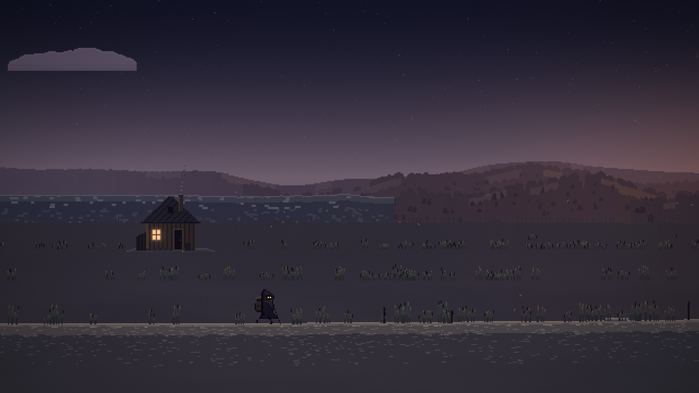

# Wander

A lone hooded wanderer walks forever through pixel-art lands made up as he goes. Day turns to night, the weather comes and goes, and the land slowly changes around him: pine forest, birch woods, meadows, autumn hills, a high plateau, a mountain pass, the coast, a desert of mesas, snowy tundra, a swamp, and a few odd places: a salt flat with dead power lines, a field of standing stones, the overgrown ruins of a town, a rail embankment. Now and then he stops to look, sits on a rock and smokes, waits out the rain under a tree; at dusk he makes a fire and sleeps beside it, and at dawn he packs up and walks on, alone with his thoughts.

Nobody plays it. It is something to look at, or to leave running for hours full screen on a second monitor.


## Run

Needs Node 25 or newer and Chromium (or Chrome) installed.

```bash
npm install
npm start
```

`npm start` runs a small local server and opens Wander in its own Chromium window, full screen, with sound. Close the window to stop it. The page also works in any modern browser at the address the server prints (`npm start -- --no-browser`).

| Key | Does |
|---|---|
| H | A small dim bar: day on the road, distance, the place, the time, the weather, `mind: claude` or `mind: local` |
| L | The log of places passed |
| M | Sound on or off |
| + / − | Louder or softer |
| F | Full screen |

### Options

The same options work on the command line (`npm start -- --seed moss --speed 20`) and as URL parameters (`?seed=moss&speed=20`).

| Option | Does |
|---|---|
| `--seed WORD` | Walk the road made from this word. The same seed and distance always give the same place. Over a saved road of another word this is only a look, and the saved road stays as it was. |
| `--new` | Start a new road, from `--seed` if given (the old save is kept as `journey.json.bak`). |
| `--speed X` | Everything runs X times faster. |
| `--day MIN` | Real minutes in a day (60 by default). |
| `--realclock` | Follow the local time of day, with the natural sun. |
| `--hour H` | Start a new road at this hour. |
| `--biome NAME` | Start a new road in this biome (`pine`, `birch`, `meadow`, `autumn`, `plateau`, `pass`, `coast`, `desert`, `tundra`, `swamp`, `saltflat`, `stones`, `ruins`, `rail`). |
| `--offline` | Never ask Claude; his own voice only. |
| `--mute` | Start with the sound off. |
| `--frozen --at M --weather W --pose P` | A still frame for pictures: time stopped at a distance, hour and weather. |
| `--no-browser`, `--port N`, `--save PATH` | Serve only; pick the port; keep the journey somewhere else. |

### His thoughts

Every three to five minutes a short line fades in beside him and out again. With `ANTHROPIC_API_KEY` set for the server, his thoughts come from Claude (one short request every few minutes, with a strict reply format; `WANDER_MODEL` picks another model), and the bar says `mind: claude`. Without a key, offline, or whenever the API is slow or failing, his own local voice speaks instead, with hundreds of lines tied to the place, the hour, the weather and the people he left behind, and the bar says `mind: local`. Nothing on screen ever waits for the API.

### The journey

The road is saved to `~/.local/share/wander/journey.json` (or under `$XDG_DATA_HOME`): its seed, how far he has come, the clock, what he is doing, and a log of the places he has passed. Close it and open it again and he goes on along the same road. While it was closed he walked on: the time away becomes distance (capped at 20 km), so you come back to somewhere new, with the places he passed in the log.

## What there is

- **The land.** Ten parallax layers at fixed depths, from distant mountains to the grass passing close to the eye, each lighter, bluer and softer the further off it stands. Everything is a pure function of the seed and the distance along the road: no two stretches are alike, and none is ever stored. Biomes blend over minutes of walking: colours, ground, plants, weather, sound.
- **The light.** Every pixel is a colour role, graded through the hour in Oklab, never darkened toward mud: dawn, golden hour, dusk, blue hour and night each have their own keys. The fire lights him and the ground around the camp; the ember of his cigarette lights the inside of his hood. Bloom, fog veils, valley mist, rain and snow at three depths, lightning, grain and a vignette are drawn at full resolution over crisp pixels.
- **The sky.** A sun and a moon in its phase, stars that twinkle near the horizon, the Milky Way on clear dark nights, aurora over the cold lands, shooting stars, and clouds that catch the sunset.
- **Landmarks,** rare: a lone house with one lit window and smoke from its chimney, a chapel, a lighthouse that flashes after dark, a radio mast with a blinking red lamp, a rusted car, a bridge over a river, a distant train with lit windows, a stone circle, a roadside shrine with a candle, a huge skeleton half in the ground, someone else's abandoned camp.
- **Life around him,** rare and quiet: a flock of birds crossing, bats at dusk, fireflies on warm nights, a deer at the edge of the trees that looks up and bounds away, a fox that trots past and stops to watch, a fish leaping under the bridge, leaves falling in the autumn woods.
- **Sound,** all synthesised in the browser: wind through the trees, rain by what it falls on, thunder after the flash, waves, crickets that slow as the night cools, birds at dawn, an owl, a train far off, his footsteps on grass, gravel, snow, sand, wood or mud, the lighter's click and a slow exhale, the fire's crackle; and soft generative music that never loops.

## Pictures

From the tour (`docs/tour/`, every biome at six times of day, the blends, every weather, pose and landmark):

| | |
|---|---|
|  |  |
|  |  |
|  |  |

Contact sheets: [biomes](docs/tour/biomes-sheet.jpg) · [blends](docs/tour/blends-sheet.jpg) · [weather](docs/tour/weather-sheet.jpg) · [poses](docs/tour/poses-sheet.jpg) · [landmarks](docs/tour/landmarks-sheet.jpg) · [life](docs/tour/life-sheet.jpg)

## Measured

On an RTX 4070, in headless Chromium on the GPU; the raw numbers are in `docs/soak/`.

| | 1920×1080 | 3840×2160 |
|---|---|---|
| Frame interval, p50 / p99 (`npm run bench`, 4 scenes × 30 s each: golden hour, a storm at dusk, a night camp, a fast walk) | 16.7 / 16.8 ms, 60 fps, no late frames | 16.7 / 16.8 ms, 60 fps, 1 late frame in 7 200 |

- **Fast soak** (`npm run soak -- --speed 16 --hours 48`): 48 in-world hours, no errors; JS heap 24.4 → 24.7 MB, GPU textures (48, 52 MB), buffers and framebuffers constant, frame time p50 16.7 / p99 16.8 ms throughout.
- **Normal soak** (`npm run soak -- --minutes 122 --hidden 20`): see `docs/soak/normal-2h.json`.
- **End to end** (`npm run check`, through the real server): closing and reopening, three hours away, offline, Claude, and a slow, failing or refused API: `docs/soak/check.txt`.

## Tools

| Command | Does |
|---|---|
| `npm test` | The tests: the world's determinism, biome blending, the brain, his life, the thought rate limit, saving and resuming, time away, the server, the landmarks. |
| `npm run shot -- --seed S --at M --hour H --weather W --size 1920x1080 --out F.png` | One frozen frame from headless Chromium on the GPU. |
| `npm run tour` | The whole tour, at 1080p and some at 4K, with contact sheets. |
| `npm run sheet` | A quick contact sheet at native size. |
| `npm run motion` | Frames 1/60 s apart and slit-scans, to check for shimmer and jitter. |
| `npm run watch -- --speed 3 --minutes 30` | Watches the road live: a screenshot, a log line and now and then a recording of the sound. |
| `npm run listen` | Records the sound of a scene and measures its loudness (EBU R 128). |
| `npm run bench` | The in-page bench: frame interval, CPU and GPU time, p50 and p99, at 1080p and 4K. |
| `npm run soak -- --speed 16 --hours 48` | Leaves it running and samples heap, GPU resources and frame time every minute. |
| `npm run art:draw`, `npm run art` | Builds the hand-drawn sprites into Aseprite files, then exports the atlas. |

## How it is made

TypeScript with no bundler: the server strips types as it serves the files (`module.stripTypeScriptTypes`). WebGL2: each layer is painted in chunks, as colour roles, into a ring texture; resolved at the native 640×360 (the view grows on screens that are not 16:9), and composited at full resolution with its own sub-pixel offset, so it scrolls smoothly without shimmer, at 3× for 1080p and 6× for 4K. The design is in [`docs/superpowers/specs/2026-10-10-wander-wanderer-design.md`](docs/superpowers/specs/2026-10-10-wander-wanderer-design.md) and the research behind it in [`docs/research/wanderer-research.md`](docs/research/wanderer-research.md).

Credits and licences: [`docs/CREDITS.md`](docs/CREDITS.md).
