# Wander

A lone hooded wanderer walks forever through pixel-art lands made up as he goes. Day turns to night, the weather comes and goes, and the land slowly changes around him: pine forest, birch woods, meadows, autumn hills, a high plateau, a mountain pass, the coast, a desert of mesas, snowy tundra, a swamp, a bare salt flat, a moor of boulders. It is all wild: nothing anyone built stands anywhere along it, and he meets no one. Now and then he stops to look, sits on a rock and smokes, waits out the rain under a tree; at dusk he makes a fire and sleeps beside it, and at dawn he packs up and walks on, alone with his thoughts.

Nobody plays it. It is something to look at, or to leave running for hours full screen on a second monitor.

On this experimental branch its second mode is [the dreaming](#the-dreaming): a small wisp wanders an endless dream world of scattered stars, faint dust clouds, distant lights and near-empty darkness. It drifts, plays, rests, and sometimes finds its way to the wanderer's fire. Two journeys, quietly bound together. Tab moves between them. The old moss creature and hollow remain available for comparison.

**Live: [krystofpe.github.io/Wander](https://krystofpe.github.io/Wander/)**: one wanderer for everyone, walking day and night. Whoever opens the page finds him in the same place at the same moment; Tab there opens a creature of your own. Or run your own road from this repository ([Run](#run)).

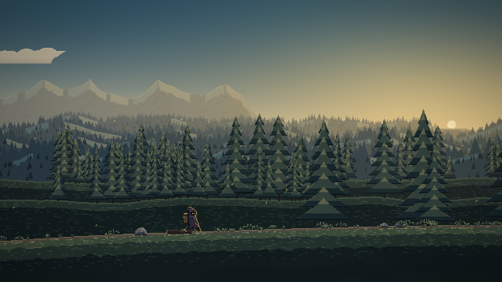

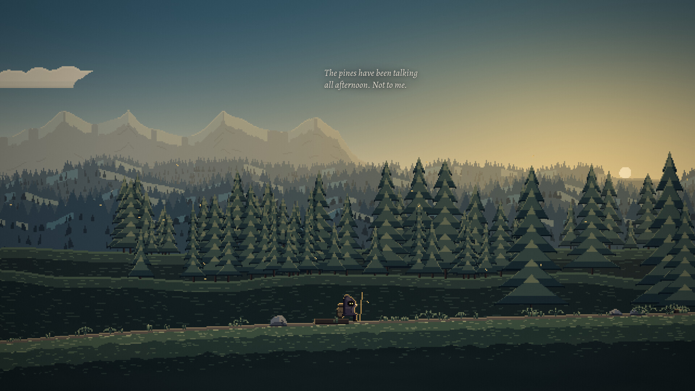

## Run

Needs Node 25 or newer and Chromium (or Chrome) installed.

```bash
npm install
npm start
```

`npm start` runs a small local server and opens Wander in its own Chromium window, full screen, with sound, in the mode you were in last (the road the first time; `npm run creature` opens the creature). Close the window to stop it. The page also works in any modern browser at the address the server prints (`npm start -- --no-browser`).

| Key | Does |
|---|---|
| Tab | The other journey: the wisp in the dreaming, or the wanderer on the road |
| H | A small dim bar: day on the road, distance, the place, the time, the weather, `mind: claude` or `mind: local` |
| L | The log of places passed |
| M | Sound on or off |
| + / − | Louder or softer |
| F | Full screen |

### Options

The same options work on the command line (`npm start -- --seed moss --speed 20`) and as URL parameters (`?seed=moss&speed=20`).

| Option | Does |
|---|---|
| `--seed WORD` | Walk the road made from this word. The same seed and distance always give the same place. Over a saved road of another word this is only a look, and the saved road stays as it was. |
| `--new` | Start a new road, from `--seed` if given (the old save is kept as `journey.json.bak`). |
| `--speed X` | Everything runs X times faster. |
| `--day MIN` | Real minutes in a day (60 by default). |
| `--realclock` | Follow the local time of day, with the natural sun. |
| `--hour H` | Start a new road at this hour. |
| `--biome NAME` | Start a new road in this biome (`pine`, `birch`, `meadow`, `autumn`, `plateau`, `pass`, `coast`, `desert`, `tundra`, `swamp`, `saltflat`, `stones`). |
| `--offline` | Never ask Claude; his own voice only. |
| `--mute` | Start with the sound off. |
| `--at M` | A look further along the road, from M metres (not saved). |
| `--visit` | A look at his camp on a new road's second night, a little before the creature comes up through its ring (not saved). |
| `--frozen --at M --weather W --pose P` | A still frame for pictures: time stopped at a distance, hour and weather. |
| `--live` | The live road of the published page instead of your own (below). |
| `--now TIME --speed X` | On the live road: show another moment (a date, or ms since 1970), running X times faster. |
| `--no-browser`, `--port N`, `--save PATH` | Serve only; pick the port; keep the journey somewhere else. |

Runs that bend time (`--speed`, `--hour`) or take pictures (`--frozen`, `--at`) are never saved, so they cannot disturb the road.

### His thoughts

Every three to five minutes a short line fades in beside him and out again. With `ANTHROPIC_API_KEY` set for the server, his thoughts come from Claude (one short request every few minutes, with a strict reply format; `WANDER_MODEL` picks another model), and the bar says `mind: claude`. Without a key, offline, or whenever the API is slow or failing, his own local voice speaks instead, with hundreds of lines tied to the place, the hour, the weather and the people he left behind, and the bar says `mind: local`. Nothing on screen ever waits for the API.

### The journey

The road is saved to `~/.local/share/wander/journey.json` (or under `$XDG_DATA_HOME`): its seed, how far he has come, the clock, what he is doing, and a log of the places he has passed. Close it and open it again and he goes on along the same road. While it was closed he walked on: the time away becomes distance (capped at 20 km), so you come back to somewhere new, with the places he passed in the log.

### The live page

[The published page](https://krystofpe.github.io/Wander/) has no server behind it and saves nothing, yet everyone sees the same wanderer. Each real hour is one of his days. At the top of every hour he lies asleep by the fire at that night's camp, and where each night's camp lies is fixed in advance, so any browser can start from the last camp and live the hour up to now, in the same half-second steps as everyone else's (`src/live.ts`). Through the day a plan brings him to the next camp by nightfall: he never walks past it, waits by it if he is early, and stops for nothing if he is late. Every hour ends exactly where the next begins (`npm run live` checks thousands of them). His thoughts there come from his own voice, picked alike for everyone; a public page cannot hold an API key. Click once for sound (browsers ask for that), double-click or F for full screen.

On this branch Tab opens the wisp's dreaming. The built site follows the actual live road: on occasional nights the two views show the same crossing. The page remembers which journey you had open last. This prototype has not been published; the public URL may still show the old hollow.

`npm run site` builds both pages into `dist/` (the TypeScript with its types stripped, the pages marked as the site and given the Google Analytics tag, so only the published pages are counted), and the [Live page workflow](.github/workflows/pages.yml) publishes it on every push to `main`. `npm run site -- --serve` then serves the build as GitHub Pages will, to look at locally first; `npm start -- --live` opens the same road with the local server.

## The dreaming

`npm run creature -- --offline` opens the prototype. A small light travels independently through four slowly blending realms, each lasting about four real minutes. Its journey continues while closed. On the live site, its crossing count catches up eligible camp visits since this browser’s wisp was born, even when the page was closed; visits viewed on the road are remembered too. It has no feeding, loneliness or neglect system: interaction adds companionship, and leaving it alone is fine.

Its guardian role appears through occasional camp crossings and the soft light it casts beside the sleeping wanderer. The dream page follows the actual road in a muted embedded view, painted only once a second until the camp is revealed. The same deterministic crossing rule drives both pages; it does not create a second imagined camp. On a local run the road continues and saves while the wisp is open; on the built site it follows the shared live road.

| Key or mouse | Does |
|---|---|
| Tab | Switch journeys |
| Move the pointer | Its eyes notice you |
| Click the wisp or Space | A brief affectionate shimmer |
| J / Escape | Open memories / close them |
| H | Keep the realm and crossing count visible |
| M, + / − | Toggle sound / change volume; click once to enable browser audio |
| F | Full screen |

Wisp memory is saved separately in browser storage as `wander.wisp.v1`; the old creature save is untouched. Clearing browser storage resets the wisp. Its appearance and dream environment are drawn procedurally, with no image assets or AI requests.

For a crossing preview: `npm run creature -- --offline --visit --speed 6`. Preview runs do not save either journey. In the browser, `?realm=0`, `1`, `2`, or `3` starts a dream realm; `?t=20` fixes the dream animation for a picture. `npm run wisp:check` verifies the browser experience and writes review pictures to `work/wisp-preview/`.

The wisp, dream scenery, motes and stepped light are all pixel art, drawn on Wander's native grid and enlarged by whole pixels without smoothing. More varied guardian actions, richer sound and dreams that echo the road's weather are future design work.

## The old hollow

The hollow and moss creature live as of October 11, 2026 are preserved in the annotated Git tag [archive/hollow-moss-live-2026-10-11](https://github.com/krystofpe/Wander/tree/archive/hollow-moss-live-2026-10-11), pointing to deployed commit `2a46527`. On GitHub, open the branch selector, select **Tags**, then choose that tag to browse or download the preserved source. It is a source snapshot, not a separate hosted website.

The [live site](https://krystofpe.github.io/Wander/) continues to use the hollow and moss creature. The wisp experiment lives on [feat/wisp-dream-journey](https://github.com/krystofpe/Wander/tree/feat/wisp-dream-journey); pushing that branch does not publish it. GitHub Pages deploys only `main`.

To run the preserved version locally in a separate directory:

```sh
git fetch origin --tags
git worktree add --detach ../Wander-hollow archive/hollow-moss-live-2026-10-11
cd ../Wander-hollow
npm ci
npm run creature -- --offline
```

Open `/creature/?hollow=1` to compare the previous creature mode, or `/?hollow=1` for its road visits. Its original behaviour is described below. The existing `creature:tour` and `creature:check` tools explicitly use this legacy mode.

In the archived version, `npm run creature` (or Tab from the road) opens the hollow and moss creature. On the wisp branch, use `/creature/?hollow=1` to open it. It wears its moss like a blanket, after a picture of one asleep: a soft mound of moss over its back and head, its face peeking out low at the front in the moss's shadow, big eyes that glow in the colour of its mood and a small mouth, little mossy paws in front, stubby mossy feet, and tiny mushrooms, one red and one sea-green, and a couple of leaves growing on top. It pads along, sits, hops, waves a paw. Unlike the wanderer, it notices you. It forages the pale caps, digs for small things, stacks stones into a cairn, chases the butterflies of light and the toy you throw, hums, watches the light come down through the openings far above, sleeps at night on its big mossy stone, its lantern lit on the stone beside it, and now and then comes up to the glass: to say hello, to bring you something it found, to ask you a question, or to tap when you have been away too long. Its behaviour is never scripted: a small brain with needs (food, rest, fun, love), a personality fixed at birth and a bond with you picks what it does next. Its clock is yours: night falls when it is night where you are, under today's moon.

The hollow is the world under his world, painted as his road is. Far above is the roof of earth and stone that is the underside of his world, vaulted, its edges catching the light from below, thin roots hanging from it. A few openings in it show the sky above at his hour (blue by day, warm at dusk, moonlit at night), and soft shafts of that light slant down through the mist. Two enormous roots of his world's trees reach down from the roof into the land. Under them, soft hills of moss go back in ranks into the mist: groves of round old trees and pale ones, ferns, bushes, flowers, mossy stones, a few toadstools glowing quietly. His road is the world in solitude; this is the world still living, and only the creature lives in it. Each of them has a fortress of solitude: his camp, and its stone. Living greens under a teal mist, graded through the hours as his road is; no weather but its mist.

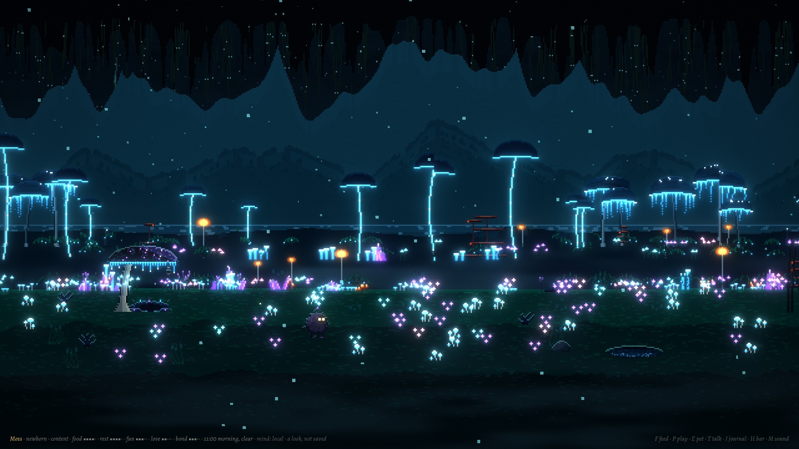

| Key or mouse | Does |
|---|---|
| F | Drop food near it; it decides whether it wants it |
| P | Throw the glowing toy; it may chase it |
| E or Space, or a click on it | Pet it, take a gift it holds out, or wake it (it may grumble) |
| T or Enter | Talk to it: type, Enter sends, Esc cancels |
| Y / N | Answer when it asks you something |
| J | Its journal: diary, finds, gifts, what it knows about you |
| H | The bar with its needs, or not |
| M, + / − | Sound on or off, louder or softer |
| A click on the ground | It goes to have a look |
| Tab | Back to the road |

Its eyes follow the pointer. When you come back to the window after a while, it notices.

The first time, a wisp drifts in, becomes the creature, and asks what to call you. After that it is saved (`~/.local/share/wander/creature.json`, the same file the terminal creature used, so one from those days moves in with its memories), and its life goes on while the window is closed: open it the next day and it will have slept, foraged, maybe found something, and it knows how long you were gone. Left alone for days it gets lonely and goes wandering, and comes back when you do. It never dies.

With `ANTHROPIC_API_KEY` set, its words come from Claude (`mind: claude` in the bar): when it greets you, visits, offers a gift, thinks aloud, and whenever you talk to it; Claude can also choose what it does next (ask it to dance) and remembers what you tell it. Without a key, or with `--offline`, its own small voice speaks (`mind: local`). Nothing on screen waits for the API.

### One world, two lives

They live far apart: he walks his road, it lives in its hollow. But every night, a while after he has lain down by his fire (from half past eleven to half past three by his clock), a ring of its mushrooms comes up in the dark beyond his camp, red and sea-green like the ones on its back, the earth inside parts on the soft light of the hollow below, motes of it rising, and the creature climbs out, pads over and sits down by the fire with him until the small hours; then it goes back down, and the moss closes over the ring. Some nights he wakes and sits up with it, the two of them by the fire; some nights he sleeps on and it keeps him company anyway. From the hollow you see it go: it says where it is going, walks across from its stone to where a shaft of light comes down from his world, its ring comes up and opens there, and it rises up the light and is gone; the ring stays, quiet, until it comes back down the light before dawn (if it is asleep itself, it sleeps through). Either way it keeps the visit: a line in its diary, whether he woke or slept, and it tells you about it the next time you open the hollow.

Both modes keep his clock: here his journey moved on since its last save at the pace he keeps while away, so both agree on when it is night at his camp; on the published page, the live road. On the default road one of his days is a real hour, so a visit lasts about ten minutes. To see one without waiting, a look that is not saved: on the road, `npm start -- --visit` (a new road's second night, him asleep by his fire half a minute before its ring comes up; `--seed moth` is a night he wakes, `--seed moss` one he sleeps through), or from the hollow, `npm run creature -- --visit` (his night begins a moment after the page opens).

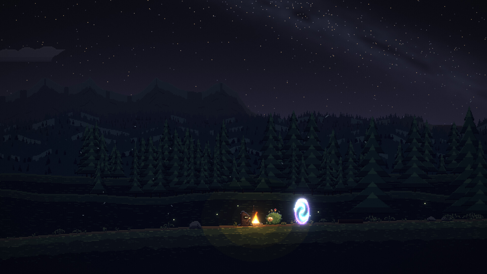

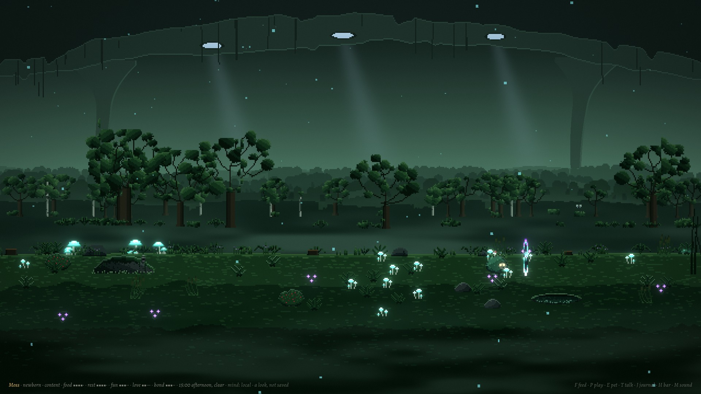

Options (`npm run creature -- --name Ori`): `--name NAME` and `--seed WORD` (a new one), `--new` (start over; the old one is kept as `creature.json.bak`), `--offline`, `--mute`, `--speed X`, `--hour H`, `--visit` (a look, not saved), `--no-browser`, `--port N`, `--save PATH`.

More: [the hollow through the day](docs/creature/deep-sheet.jpg) · [moments](docs/creature/moments-sheet.jpg) · [nights](docs/creature/nights-sheet.jpg) · [its visit](docs/creature/visit-sheet.jpg) · [you](docs/creature/you-sheet.jpg) · [later that night on his road](docs/tour/landmarks/visit-later.jpg)

## What there is

- **The land.** Ten parallax layers at fixed depths, from distant mountains to the grass passing close to the eye, each lighter, bluer and softer the further off it stands. Everything is a pure function of the seed and the distance along the road: no two stretches are alike, and none is ever stored. Biomes blend over minutes of walking: colours, ground, plants, weather, sound.
- **The light.** Every pixel is a colour role, graded through the hour in Oklab, never darkened toward mud: dawn, golden hour, dusk, blue hour and night each have their own keys. The fire lights him and the ground around the camp; the ember of his cigarette lights the inside of his hood. Bloom, fog veils, valley mist, rain and snow at three depths, lightning, grain and a vignette are drawn at full resolution over crisp pixels.
- **The sky.** A sun and a moon in its phase, stars that twinkle near the horizon, the Milky Way on clear dark nights, aurora over the cold lands, shooting stars, and clouds that catch the sunset.
- **Sights,** rare, at least two in every land, all of them natural: a lone ancient tree on a rise, a stone arch, a great boulder left by the ice, a fallen giant with its root plate standing up, a tor of stacked rocks (one a boulder balanced on a pillar), a waterfall from a cliff into a foaming pool, sea stacks off the shore, rock spires, a drowned tree in the swamp, a huge skeleton half in the ground. He stops to look at each, and remembers it by name.
- **Life around him,** rare and quiet: a flock of birds crossing, bats at dusk, fireflies on warm nights, a deer at the edge of the trees that looks up and bounds away, a fox that trots past and stops to watch, leaves falling in the autumn woods; and late at night, the creature by his fire.
- **Sound,** all synthesised in the browser: wind through the trees, rain by what it falls on, thunder after the flash, waves, crickets that slow as the night cools, birds at dawn, an owl, his footsteps on grass, gravel, snow, sand or mud, the lighter's click and a slow exhale, the fire's crackle; and soft generative music that never loops.

## Pictures

From the tour (`docs/tour/`, every biome at six times of day, the blends, every weather, pose and sight):

| | |
|---|---|
| 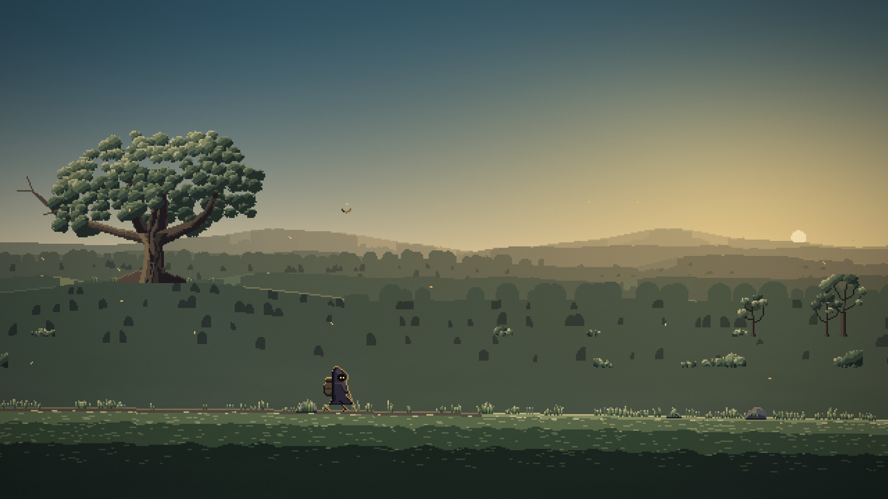 | 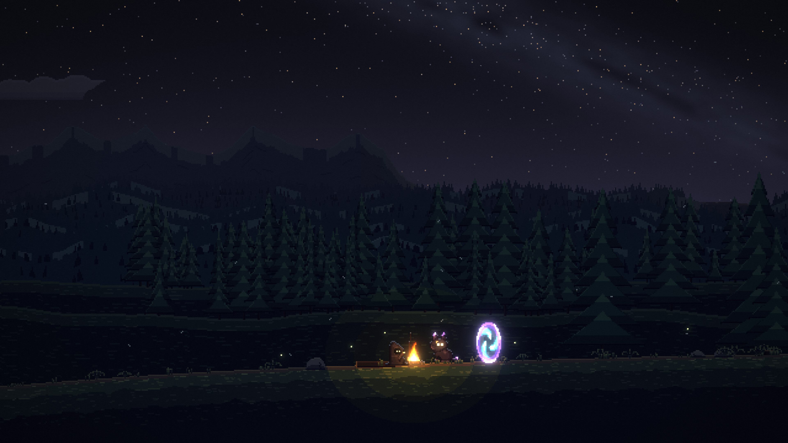 |
| 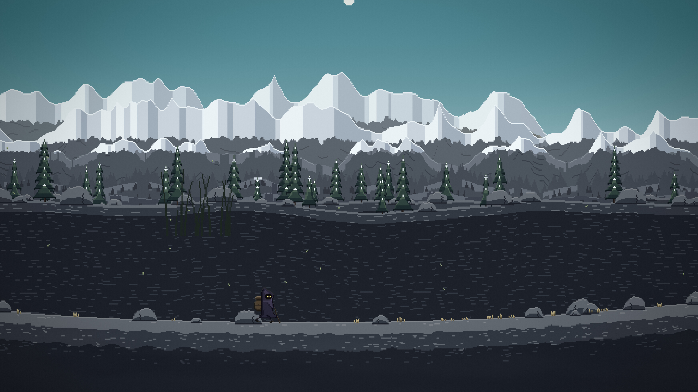 | 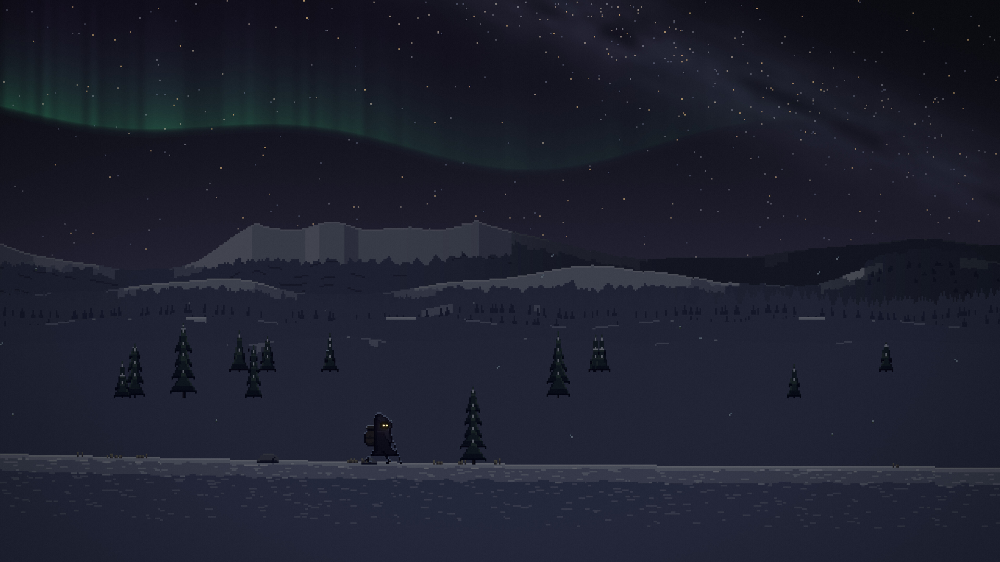 |
| 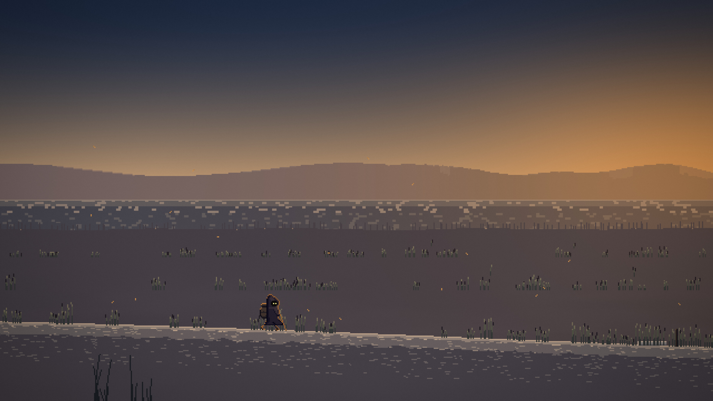 | 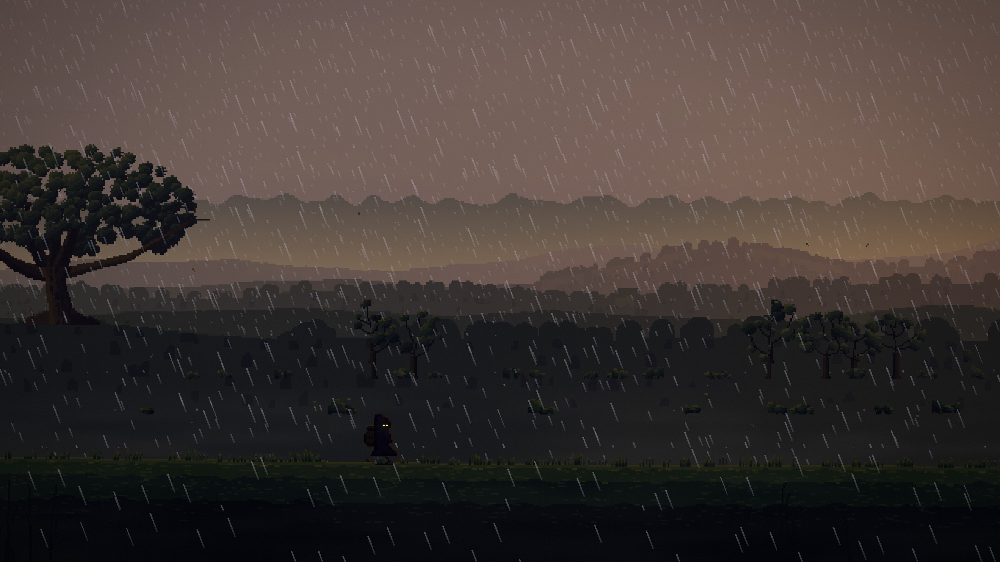 |

Contact sheets: [biomes](docs/tour/biomes-sheet.jpg) · [blends](docs/tour/blends-sheet.jpg) · [weather](docs/tour/weather-sheet.jpg) · [poses](docs/tour/poses-sheet.jpg) · [sights](docs/tour/landmarks-sheet.jpg) · [life](docs/tour/life-sheet.jpg)

## Measured

On an RTX 4070, in headless Chromium on the GPU; the raw numbers are in `docs/soak/`.

| | 1920×1080 | 3840×2160 |
|---|---|---|
| Frame interval, p50 / p99 (`npm run bench`, 4 scenes × 30 s each: golden hour, a storm at dusk, a night camp, a fast walk) | 16.7 / 16.8 ms, 60 fps, no late frames | 16.7 / 16.8 ms, 60 fps, 1 late frame in 7 200 |

- **Fast soak** (`npm run soak -- --speed 16 --hours 48`): 48 in-world hours, no errors; JS heap 24.4 → 24.7 MB, GPU textures (48, 52 MB), buffers and framebuffers constant, frame time p50 16.7 / p99 16.8 ms throughout.
- **Normal soak** (`npm run soak -- --minutes 122 --hidden 20`): two real hours at speed 1, the first 20 minutes hidden (he walked on 370 m and his steps kept sounding with 9 frames drawn), no errors; frame time p50 16.7 / p99 16.8 ms every minute once shown; GPU resources constant; the heap 21 → 27 MB in the first hour while bounded caches fill, then 26–28 MB.
- **The creature** (`docs/creature/bench.json`, its in-page bench, 20 s each): 60 fps at 1920×1080 and 3840×2160, frame interval p50 16.7 / p99 16.8 ms, CPU 0.2–0.3 ms and GPU 4.6–5.6 ms a frame, in the hollow by day and at night with its ring open. End to end (`npm run creature:check`): 24 of 24 (`docs/creature/check.txt`).
- **End to end** (`npm run check`, through the real server): closing and reopening, three hours away, offline, Claude, and a slow, failing or refused API: `docs/soak/check.txt`.

## Tools

| Command | Does |
|---|---|
| `npm test` | The tests: the world's determinism, biome blending, the brain, his life, the thought rate limit, saving and resuming, time away, the server, the landmarks. |
| `npm run shot -- --seed S --at M --hour H --weather W --size 1920x1080 --out F.png` | One frozen frame from headless Chromium on the GPU. |
| `npm run tour` | The whole tour, at 1080p and some at 4K, with contact sheets. |
| `npm run sheet` | A quick contact sheet at native size. |
| `npm run motion` | Frames 1/60 s apart and slit-scans, to check for shimmer and jitter. |
| `npm run watch -- --speed 3 --minutes 30` | Watches the road live: a screenshot, a log line and now and then a recording of the sound. |
| `npm run listen` | Records the sound of a scene and measures its loudness (EBU R 128). |
| `npm run bench` | The in-page bench: frame interval, CPU and GPU time, p50 and p99, at 1080p and 4K. |
| `npm run soak -- --speed 16 --hours 48` | Leaves it running and samples heap, GPU resources and frame time every minute. |
| `npm run live -- --hours 1000` | Lives the live road's hours one after another and checks that each ends where the next begins. |
| `npm run site` | Builds the published page into `dist/`, both modes; `-- --serve` then serves it as GitHub Pages will, to look at locally. |
| `npm run site:check` | Serves `dist/` as GitHub Pages would and checks it: the same wanderer as `src/live.ts`, the hour turning without a jump, the creature kept in the browser, its visit to the live road's camp seen from both pages, Tab both ways, the last mode opening again, the Google Analytics tag on both pages (answered with nothing, so no visits are counted), no requests for anything that is not there. |
| `npm run creature:tour` | Pictures of the creature: the hollow through the day, its moments, its nights, its visit up through its ring, you (`docs/creature/`). |
| `npm run creature:check` | The creature end to end through the real server: its first meeting, saving and reopening, days away, a terminal-era save moving in, Claude and when it fails, and one world, two lives: up through its ring to his camp at night and the visit kept, Tab both ways (`docs/creature/check.txt`). |
| `npm run art:draw`, `npm run art` | Builds the hand-drawn sprites into Aseprite files, then exports the atlas. |

## How it is made

TypeScript with no bundler: the server strips types as it serves the files (`module.stripTypeScriptTypes`). WebGL2: each layer is painted in chunks, as colour roles, into a ring texture; resolved at the native 640×360 (the view grows on screens that are not 16:9), and composited at full resolution with its own sub-pixel offset, so it scrolls smoothly without shimmer, at 3× for 1080p and 6× for 4K. The design is in [`docs/superpowers/specs/2026-10-10-wander-wanderer-design.md`](docs/superpowers/specs/2026-10-10-wander-wanderer-design.md) and the research behind it in [`docs/research/wanderer-research.md`](docs/research/wanderer-research.md).

Credits and licences: [`docs/CREDITS.md`](docs/CREDITS.md).
