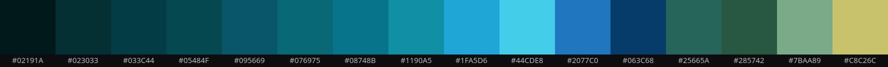

# Blackreach: research for the realm beyond the hollow

2026-10-10 · For the brief "make the place beyond the hollow an entirely different kind of place: mysterious, dark, fairytale-like; make the creature more magical and mysterious (it looks like a small copy of the wanderer)", and the follow-up "research Skyrim's Blackreach, its styling and thematics".

How it was done: web sources were read (mostly the UESP wiki, one essay, Bethesda's ESO preview; listed at the end), and four in-game screenshots of Blackreach from the UESP wiki were measured on this machine the way the forest reference was (`magick`: mean luminance, a nine-column luminance profile, a 16-colour quantisation of all four, point samples of the key things). The screenshots are Bethesda's and are not in the repository; the measured palette is (`blackreach-palette.png`). Lines marked **Wander could:** are proposals, not decisions.

## What Blackreach is

- **A world beneath the world.** Its Dwemer name, *Fal'Zhardum Din*, means "Blackest Kingdom Reaches". It is "an immense cavern located deep beneath multiple holds" of Skyrim, perhaps under all nine. You reach it through three Great Lifts at the bottom of surface ruins (Alftand, Mzinchaleft, Raldbthar): a long way down through dark halls, then a door, then a whole lit country. The game counts it as outdoors.
- **It lights itself.** "Many giant glowing mushrooms grow throughout the cavern, providing natural light." Some are larger than a person and are only scenery. A river runs through it, waterfalls drop into a lake in the south, geode veins run through the rock, and crimson nirnroot grows nowhere else, alongside the mushrooms.
- **An artificial sun.** A huge orb hangs from the cavern roof above the Silent City. It "glows a bright orange and is encased in a patterned metal shell". Shout at it and a dragon comes, Vulthuryol, "Dark Overlord Fire".
- **The ruins of a vanished people.** The Dwemer built roads, a farm (fifteen mushroom patches outside the overseer's house) and the Silent City at its heart. The Tower of Mzark holds the Oculory, "a curious device created by the Dwemer for unknown purposes" with "numerous focusing lenses". The skeleton of a researcher lies beside its controls; he "died without successfully focusing it". The Dwemer themselves are long gone, but their machines and lamps still run.
- **Who lives there now:** the Falmer, chaurus, Dwemer automatons, frost trolls, and wispmothers with their wisps, "ethereal creatures used by wispmothers to lure hapless adventurers".
- **On the surface it is a rumour.** The in-game book *Blackreach: Fictions and Facts* doubts it exists at all: perhaps "a few odd caves and the wild imaginings of some half-drunk farmer". The north's folk tales and swindlers live off the legend.

## What it is about

1. **The secret under the familiar.** Above, snow, roads and villages; below, a country nobody believes in. You find it by going down, and the reveal is the moment players remember.
2. **A sky made of stone.** No sun, no moon, no stars, yet the roof is speckled with points of light and a lamp hangs there as a sun. It is a heaven built underground by people who had none, and the Oculory, a device for focusing light that its last keeper never managed to focus, sharpens the thought.
3. **Beauty that outlived its makers.** The Silent City is empty; its lamps still burn. Ruin in Blackreach is calm, lit and lovely, not broken.
4. **Beauty and cruelty from one root.** The Dwemer kept the Falmer by feeding them "fungi that grew in the caverns which rendered the Snow Elves blind"; the glowing fungus that makes the place beautiful is the instrument of that blinding. Sparky Clarkson: "the lingering ruins of their civilization are not whitewashed jumbles of stone but the people themselves, debased and twisted almost beyond recognition."
5. **Awe and loneliness.** "Cavern spaces both colossal and claustrophobic" (Bethesda). You are small in it, and alone.

## How it looks (measured)

- **Almost one hue.** Of the 16 colours, 13 are teal, cyan or blue. The darks are teal-black (#02191A, #023033, #033C44), never neutral black. The most frequent colours are the dark teals; cyan glows (#1190A5 to #44CDE8) take a small share and a deep blue (#2077C0, #063C68) a smaller one.
- **One warm thing.** The hanging orb (sampled #C8C26C through the haze, gold at its core) and the faint gold-green of lit doorways are the only warmth. The rest of the picture is cold. This is the rule Wander already keeps (one warm accent: eyes, lantern, embers).
- **Lit by its fog, so brighter than our forest.** Mean luminance is 0.21–0.32, against 0.18 for the forest reference. The column profiles are flat (49–115 of 255, no dark frame and bright core), because the mist glows everywhere. The light is in the air, not only in the objects.
- **The giant mushrooms read as jellyfish.** Dark domed caps (#02292C), glowing undersides (#2FC3F5), and long glowing threads hanging from the rim. Small clusters glow blue-violet on the floor, and blue crystals glow from #04407F to #05A1C3.
- **Vertical light.** Glowing waterfalls and threads hang from the roof (#44E6FD) beside stalactites. Everything leads the eye up and down, not only across.
- **The stone sky.** The roof is darkness (#013236) with sparse, dim blue specks (#03435E), and motes drift down through everything like slow snow.
- **Depth by mist.** Three or four planes, each further one dissolving into the teal. The architecture stands as dark, flat silhouettes in the haze: blocky, geometric, arches and domes, bridges over chasms.

## Next to Wander

- **The forest reference is a cousin already.** The teal gloomy forest the user chose on 2026-10-09 (see `forest-reference-rules`) has the same teal-black darks, a glow, spores, glowing mushrooms and eyes in the dark. Blackreach adds the stone sky instead of a sky, jellyfish mushrooms with hanging threads, vertical light, an artificial sun, ruins of the vanished, and still water.
- **It fits the agreed mood and touchstones.** It is mysterious, lonely and sad rather than cozy: an empty world with one warm light. It is *Below*'s tiny figure in a vast dark world, and *Hyper Light Drifter*'s cool world with one repeated warm accent.
- **What to leave behind:** the combat, the Falmer's grotesque cruelty, and copies of Dwemer bronze. The realm should be ours, taking the ideas, not the props.

## What the realm beyond the hollow could take from it

1. **The hollow is the lift.** The hollow at the foot of the great tree goes down: the creature's realm lies beneath his road. **Wander could:** make Tab into the hollow a descent (a fade down through roots), and Tab out of it the climb back.
2. **A stone sky instead of the sky.** **Wander could:** replace the sky layers with a cavern roof of teal-black stone, with sparse specks that brighten and fade slowly and stalactites at the top edge. There would be no sun and no moon.
3. **An old lamp for a sun.** **Wander could:** hang a great lamp left by a vanished people far off in the roof. It would be the realm's one warm light besides the creature's eyes and lantern, bright by day and dim at night with the surface clock, so the realm still has day and night (teal and violet, as the forest had).
4. **Jellyfish mushrooms for trees.** **Wander could:** paint the far, middle and near planes with giant domed caps on pale stems, their undersides glowing and threads swaying from their rims. Below them would be small glowing clusters, blue crystals, and stalagmites in place of rocks.
5. **Vertical light.** **Wander could:** add thin glowing threads and one or two falls of water from the roof, catching the glow, with slow drips.
6. **Mist in planes, ruins in the haze.** **Wander could:** fill the space between depth planes with glowing teal mist, and show the far silhouettes of the vanished people: an arch, a broken tower, a bridge over nothing, a great orrery. Each should be our own invention, not Dwemer.
7. **Still water.** **Wander could:** add a black pool that mirrors the glow, its surface broken now and then by a drip or a pale blind fish.
8. **Small lives of the deep.** **Wander could:** have motes drifting down, wisps (small lights that wander, gather and scatter), pale cave moths, the eyes in the dark between the stalks, and a slow luminous jelly drifting through the air.
9. **The sound of underground.** **Wander could:** play drips, far water, a low drone, the faint hum of the old lamp, and an echo on its footsteps, with no wind and no birds.
10. **His visits: light from above.** **Wander could:** at the realm's edge, let a shaft of his world's light fall through the hollow's mouth far above: daylight, or moonlight, or rain. When he sits at the door up there, his smoke drifts down the shaft and his silhouette shows at the top. The creature climbs the roots into the light to sit with him, and the realm sees the visit as light, not as a man walking through.

## The creature, as one of the deep

It now looks like the wanderer made small: a hooded cloak, a dark face, two eyes. A creature of this realm should belong to it. Directions:

- **A mushroom child.** A small dark body under a wide cap that glows underneath, threads hanging from the rim that sway when it moves. Its eyes glow in the shade of the cap. It is what grows there, and its flat, wide cap is the opposite of his pointed hood.
- **A masked wisp.** A pale mask with eye holes for its glowing eyes, and a body of mist that frays into motes at the bottom. It floats a little above the ground, kin to the wisps.
- **A cave moth.** A soft round body with feathery antennae and dusty wings folded like a cloak, which open when it is startled or glad. It trails pale dust when it moves.
- **A blend of the first two.** A mushroom child whose cap is also its mask, and whose threads leave motes as it floats.

## Later: the Underdark (Baldur's Gate 3)

Asked for later ("make it a little more rich in elements, lose the light on top, draw inspiration from the Underdark of Baldur's Gate"), two screenshots from the BG3 wiki were measured the same way (`Underdark.jpg`, `Phalar_Aluve_Location.jpg`):

- **Darker than Blackreach:** mean luminance 0.13–0.17, against 0.21–0.32 for Blackreach and 0.18 for the forest reference. The base is navy-black, not teal: #040E18, #091928, #0F2536, #10314A.
- **Many glows, not one hue:** blue and cyan (#276897, #4BA5E0, tube fungi #28D7F5), amber caps (#C98356), red bulbs (#92443F), violet crystal, pale blue caps on stems that glow white.
- **Its things:** giant mushrooms of several kinds (Torchstalks, Timmasks, Bibberbang, Nightlight, Barrelstalk), red shelf fungi stacked up their stalks, tube fungi, purple coral-like growth, crystal, huge dark stalactites, a dark lake (the Ebonlake), ruins and urns, petrified statues, bones, webs, spore clouds (bg3.wiki).

**The deep took:** the navy base and darkness, the many kinds of growth (tall pale-stemmed caps, torch-caps kept dull so they do not read as lamps, coral shelves, red bulbs, tube fungi, violet crystal, purple coral), the broken pillars and urns, the dark lake, and huge stalactites. **It dropped:** the old lamp, and the threads of light from the roof.

## Sources

- UESP, *Skyrim:Blackreach*: https://en.uesp.net/wiki/Skyrim:Blackreach
- UESP, *Lore:Blackreach*: https://en.uesp.net/wiki/Lore:Blackreach
- UESP, *Skyrim:Glowing Mushroom*: https://en.uesp.net/wiki/Skyrim:Glowing_Mushroom
- UESP, *Skyrim:Tower of Mzark*: https://en.uesp.net/wiki/Skyrim:Tower_of_Mzark
- UESP, *Skyrim:Vulthuryol* (the orb): https://en.uesp.net/wiki/Skyrim:Vulthuryol
- UESP, *Skyrim:Wispmother*: https://en.uesp.net/wiki/Skyrim:Wispmother
- UESP, *Lore:Blackreach: Fictions and Facts*: https://en.uesp.net/wiki/Lore:Blackreach:_Fictions_and_Facts
- UESP, *Skyrim:Music*: https://en.uesp.net/wiki/Skyrim:Music
- Sparky Clarkson, "Skyrim: A Dirge for the Falmer", GameCritics: https://gamecritics.com/sparky-clarkson/skyrim-a-dirge-for-the-falmer/
- Bethesda, "Greymoor: Western Skyrim and Blackreach preview": https://bethesda.net/en-US/news/greymoor-western-skyrim-blackreach-preview
- BG3 wiki, *Underdark*: https://bg3.wiki/wiki/Underdark, and its images `Underdark.jpg`, `Phalar_Aluve_Location.jpg` (measured, not in the repository).
- The four screenshots measured: UESP images `SR-place-Blackreach.jpg`, `_02`, `_03`, `_04` (https://images.uesp.net/0/00/SR-place-Blackreach.jpg and siblings).

## What could not be found

- **The fandom wiki** (skyrim.fandom.com) refused the request (HTTP 402).
- **No developer interview or talk on Blackreach's art direction** turned up, so the reading of its look above is from measurement and observation, not the designers' words.
- **Which music plays in Blackreach** is not stated on the UESP music page. Its dungeon and cave tracks ("Into Darkness", "Silence Unbroken", "Silent Footsteps", "Shadows and Echoes", "Death in the Darkness") are the likely set; "Night Without Stars" fits the name but its use is unconfirmed.
- **Adam Adamowicz's concept art** covers the Falmer and Dwemer ruins, but no Blackreach concept piece was found.
